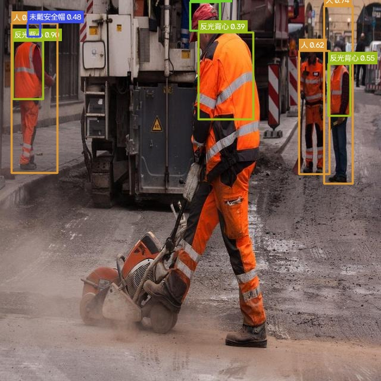

# 施工场地安全帽 / 反光背心检测（YOLOv8n + X-AnyLabeling）

**在 1206 张真实工地照片上，用同一份 ONNX 权重把「是否戴安全帽、是否穿反光背心」逐人判出来；
把整图单尺度换成双尺度联合推理后，mAP@50 从 0.5401 提升到 0.5819，大目标召回从 0.739 提升到 0.803，
代价是单图耗时 43 → 90 ms（CPU，无 CUDA）。**

不需要 torch，不需要 CUDA。`uv pip install -r requirements.txt` 之后一条 `python run.py --all` 即可复现全部数字。

---

## 一句话演示



左边原图、右边模型输出的三视图对比在 [`web/index.html`](web/index.html)（双击打开，纯静态、离线可看）：
32 张精挑图 + 6 张最差样本，每张都能切换「原图 / 数据集真值 / 模型预测」并显示逐类框数。

**实验室里的 30 秒版本**：双击桌面快捷方式「X-AnyLabeling 标注演示」——
程序直接停在 `demo2/images` 的第一张图上（标题栏 `[1/60]`），框与中文标签都已画好，`D` / `A` 翻页。

## 适用范围（先说清楚，再说能力）

| | 适用 | 不适用 |
|---|---|---|
| 场景 | 白天、室外、中景工地的静态图片批处理 | 夜间、强逆光、浓雾 |
| 目标 | 边长 ≥48 px 的人 / 安全帽 / 反光背心 | 远处不足 16 px 的头部 |
| 用途 | 标注辅助（预标注 + 人工校正）、课堂演示、离线批量筛查 | 实时告警、门禁联动、替代人工验收 |
| 密度 | 单人至中等人群（≤8 人同框较稳） | 人群密集、长焦远景堆叠 |

边界不是免责声明，而是有实验支撑的结论：第九节 A/B 里「分块放大」掉点一半以上，
第十节 6 张最差样本里三种失败模式都能复现。**本项目不做训练微调**（环境无 CUDA 工具链、未装 torch），
所有数字都来自公开预训练权重 `construction-ppe-safety` 的推理结果。

---

## 快速开始

```powershell
# 1) 装依赖（推理与评估只需这 4 个包，合计 ~120 MB；不装 torch）
uv venv .venv --python 3.12
uv pip install -r requirements.txt          # 或 python -m pip install -r requirements.txt

# 2) 跑通全流程（推理 → 评估 → A/B → 三视图 → 失败案例 → 重建网页，约 13 分钟，CPU）
python run.py --all

# 3) 打开结果
start web\index.html                        # 只用看页面的话，第 1 步也可以跳过
```

`run.py` 的每一步都能单独跑：

```powershell
python run.py --infer       # tools/yolo_onnx_predict.py   -> out/pred_test.json
python run.py --eval        # tools/run_full_eval.py       -> out/full_eval_summary.json
python run.py --ab          # tools/ab_tiled.py            -> out/ab_tiled{,_valid}.json
python run.py --painting    # tools/render_demo{,2}.py     -> web/assets{,2}/
python run.py --failures    # tools/render_failures.py     -> web/assets3/, out/failure_stats.json
python run.py --web         # tools/build_web.py           -> web/index.html
python run.py --gui         # 打开 X-AnyLabeling 标注演示
```

### 在 X-AnyLabeling 里用（自动标注）

已注册到 `%USERPROFILE%\.xanylabelingrc`（即 `C:\Users\<你>\.xanylabelingrc`）两条自定义模型：

```yaml
custom_models:
  - config_file: <repo>\models\ppe_yolov8n.yaml          # 10 类原始权重，接口/评估用
    is_custom_model: true
    last_used: 0.0
  - config_file: <repo>\models\ppe_demo_trained.yaml     # 本项目 8 轮训练产物（5 类）
    is_custom_model: true
    last_used: 0.0
```

打开 `demo2/images` → `Ctrl+A` 打开自动标注面板 → 模型下拉框选「PPE 演示训练模型 (YOLOv8n, 8 轮 CPU)」→ 点 `Run (i)` 跑当前图，或 `Ctrl+B` 批量跑整个文件夹。
**自动标注会覆盖现有 `.json`**，重跑前先备份（把 `demo2/images/*.json` 复制到别处即可）。

标注 → 训练 → 导出 → 接回的完整分步流程，见 [`docs/全链路操作手册.md`](docs/全链路操作手册.md)。

其他文档：

- [`docs/四问解答.md`](docs/四问解答.md)：创新点、作品价值、实现方式、GitHub 与 YOLO 使用体验（四问逐条作答，数字全部可追到 `out/*.json`）。
- [`docs/文件索引.md`](docs/文件索引.md)：测试图片、核心代码（带行号）、结果 JSON、权重与训练证据的完整路径清单。

> 中文类别名需要一处源码补丁：`anylabeling/services/auto_labeling/model.py` 的
> `open(model_config, "r")` 必须改成 `open(model_config, "r", encoding="utf-8")`，
> 否则中文 Windows 按 GBK 解码直接抛 `UnicodeDecodeError`。原文件已备份 `.orig`，
> 重装/升级 X-AnyLabeling 会覆盖它。

---

## 实测结果

### 1. 基线：整图单尺度（全量 1206 张，逐张推理）

| 划分 | 图片 | 真值框 | 预测框 | mAP@50 | mAP@50-95 |
|---|---|---|---|---|---|
| 训练集 | 997 | 6386 | 9116 | 0.5547 | 0.2385 |
| 验证集 | 119 | 715 | 928 | 0.5696 | 0.2692 |
| **测试集** | **90** | **623** | **861** | **0.5401** | **0.2212** |
| 合计（加权） | 1206 | 7724 | 10905 | 0.5556 | — |

测试集逐类（IoU≥0.5，101 点插值）：

| 类别 | AP@50 | AP@50-95 | P (@0.35) | R (@0.35) | 真值框 |
|---|---|---|---|---|---|
| 安全帽 | **0.798** | 0.374 | 0.810 | 0.831 | 195 |
| 人 | **0.727** | 0.309 | 0.746 | 0.836 | 214 |
| 反光背心 | 0.523 | 0.243 | 0.693 | 0.612 | 129 |
| 未穿反光背心 | 0.378 | 0.115 | 0.413 | 0.623 | 61 |
| 未戴安全帽 | 0.275 | 0.065 | 0.391 | 0.375 | 24 |

CPU 单图 **43 ms**（12 核，ONNX Runtime 1.31.1；不同运行间抖动 ±10 ms）。

`no-helmet` 低是**数据问题不是模型问题**：测试集只有 24 个该类框（3.9%），
训练集 997 张里也只有 94 个（1.4%）。这正是「补拍现场数据后微调」的动机。

### 2. A/B：整图 vs 缩图多尺度 vs 分块（同一权重、同一测试集）

| 策略 | mAP@50 | mAP@50-95 | 框/图 | 耗时 ms/图 | 相对基线 |
|---|---|---|---|---|---|
| A · 整图基线 | 0.5401 | 0.2212 | 9.57 | 43 | — |
| **B · 缩图多尺度（采用）** | **0.5819** | **0.2319** | 10.37 | 90 | **+0.0418** |
| C · 分块 2×2（负面对照） | 0.2613 | 0.0817 | 15.11 | 184 | −0.2788 |

按目标边长拆开看召回（这才是改动的真实作用点）：

| 策略 | 小 <48px | 中 48–96px | 大 ≥96px |
|---|---|---|---|
| A | 0.7733 (58/75) | 0.7647 (117/153) | 0.7392 (292/395) |
| B | 0.7733 (58/75) | 0.7712 (118/153) | **0.8025 (317/395)** |
| C | 0.8000 (60/75) | 0.6928 (106/153) | 0.4608 (182/395) |

验证集 119 张复核：A 0.5696 → B **0.6201**（+0.0505），大目标召回 0.7715 → 0.8344。
两个划分方向一致，不是测试集偶然。

**这组对照的诚实边界**：B 换来的是「大中目标判得更稳」，不是「小目标也能看见」
（小目标召回 0.7733 → 0.7733，一点没变）；代价是耗时接近翻倍。
C 证明「分块放大能救小目标」这个直觉在本模型上会翻车——每块被强制放大回 640 后，
尺度分布偏离训练分布，大目标召回直接腰斩。

### 3. 失败案例（测试集最差 6 张）

| 图片 | 真值 | 命中 | 误检 | 漏检 | 主要问题 |
|---|---|---|---|---|---|
| ppe_0357 | 23 | 15 | 12 | 8 | 漏「人」4 个；误检「未穿背心」8 个 |
| ppe_0675 | 21 | 13 | 11 | 8 | 漏「安全帽」6 个 |
| ppe_0575 | 12 | 7 | 7 | 5 | 漏「未穿背心」3 个，以大目标为主 |
| ppe_0261 | 1 | 1 | 16 | 0 | 纯误检：安全帽 6 / 背心 5 / 人 5 |
| ppe_0008 | 11 | 5 | 3 | 6 | 漏「未戴安全帽」3 个 |
| ppe_0643 | 9 | 3 | 2 | 6 | 漏「人」3 + 「背心」3，全是大目标 |

三种失败模式：① 「未戴口罩」通道与「未戴安全帽」特征重合导致误判；② 人群密集时人框与帽子框错配；
③ 极小目标 / 逆光。前两条属后处理与类别口径问题，第三条只能靠补数据重训。
渲染脚本 `tools/render_failures.py`，图片在 `web/assets3/`（绿=命中、红=误检、橙虚线=漏检）。

---

## 结构与脚本

```
ppe-demo/
├── README.md  requirements.txt  run.py  LICENSE  .gitignore
├── data.yaml                          YOLO 数据集描述（5 类，供训练与导出用）
├── classes.txt                        导出 YOLO 标注用的类别表（UTF-8 无 BOM）
├── models/
│   ├── construction_ppe_yolov8n.onnx   预训练权重 12.2 MB（CC BY 4.0，10 类）
│   ├── demo_trained_yolov8n.onnx       本项目 8 轮训练导出的 ONNX 12.8 MB（5 类）
│   ├── ppe_yolov8n.yaml                X-AnyLabeling 自定义模型配置（中文类别 + filter_classes）
│   ├── ppe_demo_trained.yaml           本项目训练产物接入配置（5 类，指向同目录 demo_trained_yolov8n.onnx）
│   └── ppe_yolov8n.yaml.bak-en         英文类别原版备份
├── weights/yolov8n.pt                  训练起点（COCO 官方权重，AGPL；不随仓库发布，ultralytics 首次使用会自动下载）
├── runs/demo_train/                    8 轮 CPU 训练产物：best.pt / best.onnx / results.csv / 曲线（体积大，未随仓库发布；
│                                       ONNX 副本已放 models/demo_trained_yolov8n.onnx，训练日志见 docs/demo_train_*.csv|yaml）
├── demo/{images,labels}/               32 张精挑演示图 + JSON 标注 + 真值
├── demo2/{images,labels}/              60 张扩展测试图（含负样本，四类等距抽样）
├── {train,valid,test}/{images,labels}  全量 1206 张（997 / 119 / 90）
├── tools/
│   ├── yolo_onnx_predict.py            纯 ONNX 推理 + 画框 + 合规计数（手写 letterbox/NMS）
│   ├── ab_tiled.py                     多尺度 / 分块 / TTA 的 A/B 实验框架
│   ├── eval_vs_gt.py                   mAP / P / R 评估（numpy 手写，101 点插值）
│   ├── run_full_eval.py                三个划分批量评估
│   ├── render_failures.py              挑最差样本并渲染失败案例
│   ├── auto_label_json.py              调 X-AnyLabeling 模型批量生成 JSON 标注
│   ├── translate_labels.py             英文标签 → 中文（同批改写 description）
│   ├── prune_labels.py                 裁到 5 类报告口径
│   ├── build_demo_set.py / build_demo2.py   挑演示图与扩展测试集
│   ├── render_demo.py / render_demo2.py     渲染三视图
│   ├── build_web.py                    从 out/*.json 生成网页（不写死任何数字）
│   ├── check_viewer.js / check_numbers.py   页面交互与数字自检
│   ├── test_xal_model.py / check_doc_paths.py   自定义模型加载自检、文档路径自检
│   ├── ppt_kit.py                      答辩 PPT 的排版工具层（配色、表格、柱状图、页眉页脚）
│   ├── build_ppt_final.py              生成 17 页最终答辩 PPT（三个导师问题的答法）
│   ├── check_ppt.py / check_no_demo.py      版面越界 / 溢出 / 压图自检，以及「不出现演示提示」自检
│   └── check_gui_load.py / verify_annotations.py   无头模式验证 GUI 与 .json 加载
├── out/                                指标 json、A/B 结果、失败统计
├── docs/
│   ├── PPE答辩汇报-最终版.pptx           17 页最终答辩版（导师三问 + 三个创新点，图直接取 web/assets3）
│   ├── 全链路操作手册.md                 导入→标注→训练→导出→接回，分步菜单路径与实测参数
│   ├── demo_train_results.csv          8 轮训练逐轮指标（从 runs/demo_train 复制）
│   └── demo_train_args.yaml            训练超参数快照（8 轮 / 416px / CPU / fraction 0.25）
└── web/
    ├── index.html                      ✦ 演示页面（唯一需要打开的入口）
    ├── assets/  assets3/               三视图 / 失败案例
```

**关键实现说明**

- **不用 ultralytics 推理**：`yolo_onnx_predict.py` 自己实现 letterbox、坐标反算、类别解码与 NMS，
  只依赖 onnxruntime + numpy + opencv，因此 4 GB 显存与无 CUDA 的机器也能跑。
- **类别索引必须保持 10 项**：它是 ONNX 输出通道顺序，少写一项后面名字全部错位。
  要裁类别用 `filter_classes`（只报告安全帽 / 未戴安全帽 / 反光背心 / 未穿反光背心 / 人 这 5 类）。
- **多尺度坐标映射**：0.5× 副本的预测框按 `fx, fy` 反算回原图再与主尺度一起做 NMS，
  否则两套尺度无法合并。
- **中文路径**：`cv2.imread` 在 Windows 上读不了含中文的路径，全部改用
  `cv2.imdecode(np.fromfile(p, np.uint8), cv2.IMREAD_COLOR)`。

---

## 数据与许可

- **数据**：Roboflow Universe `construction-safety-gsnvb`（**CC BY 4.0**），
  经 `hf-mirror.com/datasets/LibreYOLO/construction-safety-gsnvb` 下载（本机到 HF 官方域名全部超时）。
  1206 张真实工地照片，YOLO 格式标注，5 类：helmet / no-helmet / no-vest / person / vest。
- **权重**：Hugging Face `mancalazure/construction-ppe-safety`（**CC BY 4.0**），
  YOLOv8n 在 Roboflow `construction-site-safety v28` 上微调，ONNX opset 12，12,245,828 字节，
  SHA256 `1D5F3CF69883E89BA6E2B3836A0B21623044E9A682F1F00DFBACAC97B99BAF94`。
- **代码**：MIT（见 [`LICENSE`](LICENSE)，其中列明了不与 MIT 混用的第三方资产条款）。
- **隐私**：照片含真实人脸，仅用于课堂演示，不作为人脸数据集再分发；对外展示建议先打码。

## 版本与引用

- 版本：**v1.0.0**（2026-11-23）
- 工具链：X-AnyLabeling 4.3.1 · ONNX Runtime 1.31.1 (CPU) · OpenCV 5.0.0.93 · numpy 2.5.4 · Python 3.12.16

```bibtex
@misc{ppe_demo_2026,
  title  = {Construction PPE Detection Demo: YOLOv8n + X-AnyLabeling},
  year   = {2026},
  note   = {mAP@50 0.5401 -> 0.5819 via dual-scale inference on 1206 real site photos},
  url    = {https://github.com/<your-account>/ppe-demo}
}
```

## 已知问题与下一步

| 阶段 | 做什么 | 预期 |
|---|---|---|
| 近期 | 把 60 张扩展测试图的漏检手工补齐（尤其未戴安全帽），形成「自动 vs 人工」对照子集 | 课堂演示可直接展示人工校正量 |
| 近期 | 补拍 300–500 张本场景照片，重点补负样本（未戴帽、逆光、夜间） | no-helmet AP 从 0.275 起步提升 |
| 中期 | 装 `torch[cuda]` + ultralytics，用 GTX 1650（4 GB）微调 YOLOv8n/s，imgsz=640，batch 8–16，AMP | mAP@50 目标 0.75+ |
| 中期 | 人和 PPE 用 IoU 矩阵 + 匈牙利匹配做配对，替代当前的「面积占比 >25% 包含关系」 | 消除人群密集时的张冠李戴 |
| 远期 | 导出 TensorRT、接 RTSP 流做实时告警（>15 FPS） | 从「演示」到「能用」 |
| 远期 | 加 ByteTrack + 违规去重，避免同一人重复告警 | 告警可用性 |
